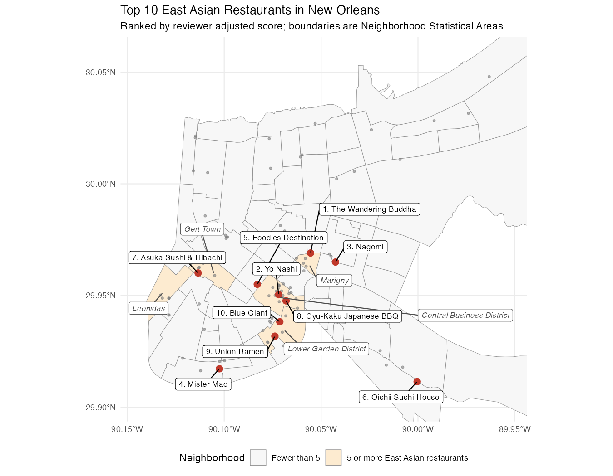
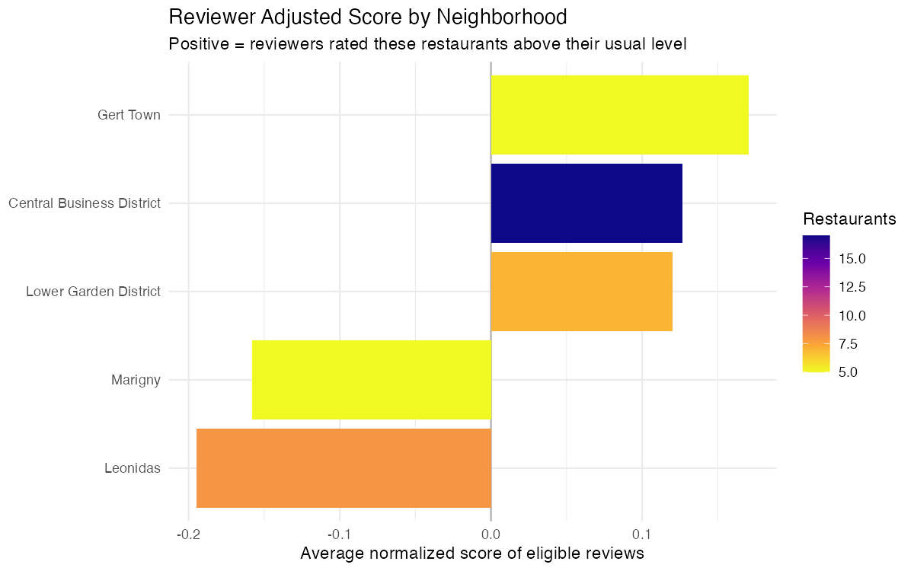

```{r}
library(tidyverse)
library(knitr)

top10 <- read_csv("output/top10.csv", show_col_types = FALSE)
hoods <- read_csv("output/neighborhood_comparison.csv", show_col_types = FALSE)
sens <- read_csv("output/sensitivity.csv", show_col_types = FALSE)
n_first <- sum(sens$number_one == top10$business_name[1])
adj_sorted <- sort(hoods$avg_adjusted, decreasing = TRUE)

best_adj <- hoods |> filter(rank_adjusted == 1) |> pull(neighborhood)
best_raw <- hoods |> filter(rank_raw == 1) |> pull(neighborhood)
most_top10 <- hoods |> filter(top10_restaurants == max(top10_restaurants)) |> pull(neighborhood)
```

# Where to Find the Best East Asian Food in New Orleans

**Research question:** Where can someone find the best East Asian (Korean, Japanese, and Chinese) restaurants in New Orleans, and which neighborhood is best for finding them?

**[View the complete report](https://boseongkang.github.io/yelp/)** (tables, maps, code, and methods)

## Executive summary

Using 2,259 New Orleans restaurants and 476,421 reviews from the Yelp Open Dataset, I selected the East Asian restaurants inside the city, placed them in the city's official neighborhoods, and ranked them with a reviewer adjusted score that removes how generous or strict each reviewer usually is. The top ranked restaurant is **`r top10$business_name[1]`** in `r top10$neighborhood[1]`, and the best neighborhood after adjustment is **`r paste(best_adj, collapse = " and ")`**. Both leads are narrow, and the best area changes if ZIP codes are used instead of neighborhoods; the report explains these limits.

## Main findings

1. **`r paste(best_adj, collapse = " and ")`** has the highest reviewer adjusted score among neighborhoods with at least 5 East Asian restaurants. `r raw_sorted <- sort(hoods$avg_raw, decreasing = TRUE); if (setequal(best_raw, best_adj)) "It is also first by the ordinary Yelp average." else paste0("By the ordinary Yelp average, ", paste(best_raw, collapse = " and "), " is first by only ", round(raw_sorted[1] - raw_sorted[2], 2), " stars, effectively a tie.")` `r paste(best_adj, collapse = " and ")`'s lead on the adjusted score is small (`r round(adj_sorted[1], 2)` against `r round(adj_sorted[2], 2)` for second place).
2. **The best restaurants are spread out.** `r sum(top10$neighborhood %in% hoods$neighborhood)` of the top 10 are in one of the `r nrow(hoods)` neighborhoods with at least 5 East Asian restaurants, and the other `r 10 - sum(top10$neighborhood %in% hoods$neighborhood)` are in neighborhoods with fewer`r if (!(top10$neighborhood[1] %in% hoods$neighborhood)) ", including the number one restaurant" else ""`. For the most choice, `r hoods$neighborhood[which.max(hoods$restaurants)]` has the most East Asian restaurants (`r max(hoods$restaurants)`).
3. **Most of the top group holds, the exact order does not.** When the way reviewer habits are measured is changed (6 settings), `r min(sens$same_as_main_top10)` to `r max(sens$same_as_main_top10)` of the main top 10 stay in the top 10 (`r sum(sens$same_as_main_top10 >= 7)` of the 6 settings keep at least 7), but the number one restaurant changes: `r top10$business_name[1]` is first in `r n_first` of the 6 settings. The list is best read as a set of strong East Asian restaurants rather than a strict ranking.



```{r}
top10 |>
  mutate(avg_stars_all = round(avg_stars_all, 2),
         avg_normalized = round(avg_normalized, 2)) |>
  kable(col.names = c("Rank", "Restaurant", "Cuisine", "Neighborhood", "Reviews",
                      "Raw average", "Eligible reviews", "Normalized score"))
```



## Repository contents and source code

| Path | Contents |
|---|---|
| [`yelp_new_orleans_project.qmd`](yelp_new_orleans_project.qmd) | Source of the full report (Steps 1 to 7, top 10, AI prompts) |
| [`docs/index.html`](docs/index.html) | Rendered report, published with GitHub Pages |
| [`R/import.R`](R/import.R) | Imports the raw JSON files, filters to New Orleans restaurants, saves RDS |
| [`README.qmd`](README.qmd) | Source of this README (reads the result tables in `output/`) |
| [`renv.lock`](renv.lock) | Package versions used |
| [`analysis.qmd`](analysis.qmd), [`analysis.md`](analysis.md) | Homework 6 version of Steps 3 to 6 (geographic system comparison), made before the inclusion rule was tightened |
| [`data/new_orleans/`](data/new_orleans) | Filtered business and review data (compressed RDS) |
| [`data/boundaries/`](data/boundaries) | New Orleans Neighborhood Statistical Areas (data.nola.gov) |
| [`figures/`](figures) | Saved figures used in this README |
| [`output/`](output) | Result tables (top 10, neighborhood comparison, restaurant summary, reviewer thresholds, sensitivity) |

## Data and reproduction

Data source: [Yelp Open Dataset](https://business.yelp.com/data/resources/open-dataset/) (Download JSON: 4.35 GB TAR, 8.65 GB uncompressed). Neighborhood boundaries: City of New Orleans Neighborhood Statistical Areas (data.nola.gov, dataset `exvn-jeh2`). Census places, tracts, and ZIP code areas are downloaded with the `tigris` package.

The raw JSON files are **not committed** because they are too large for GitHub (the review file alone is 5.0 GB). To reproduce:

1. Download the Yelp JSON dataset and extract it into `data/raw/` (git ignored). Only `yelp_academic_dataset_business.json` and `yelp_academic_dataset_review.json` are used.
2. Run `R/import.R` once. It reads the review file in chunks and saves the filtered data to `data/new_orleans/`.
3. Render the report: `quarto render yelp_new_orleans_project.qmd --output-dir docs`
4. Render this README: `quarto render README.qmd`

Package versions used for the report are recorded in `renv.lock` (and printed at the end of the report with `sessionInfo()`); `renv::restore()` installs the same versions.

The report is published from the `docs/` folder with GitHub Pages (Settings, Pages, Deploy from a branch, `main`, `/docs`).
